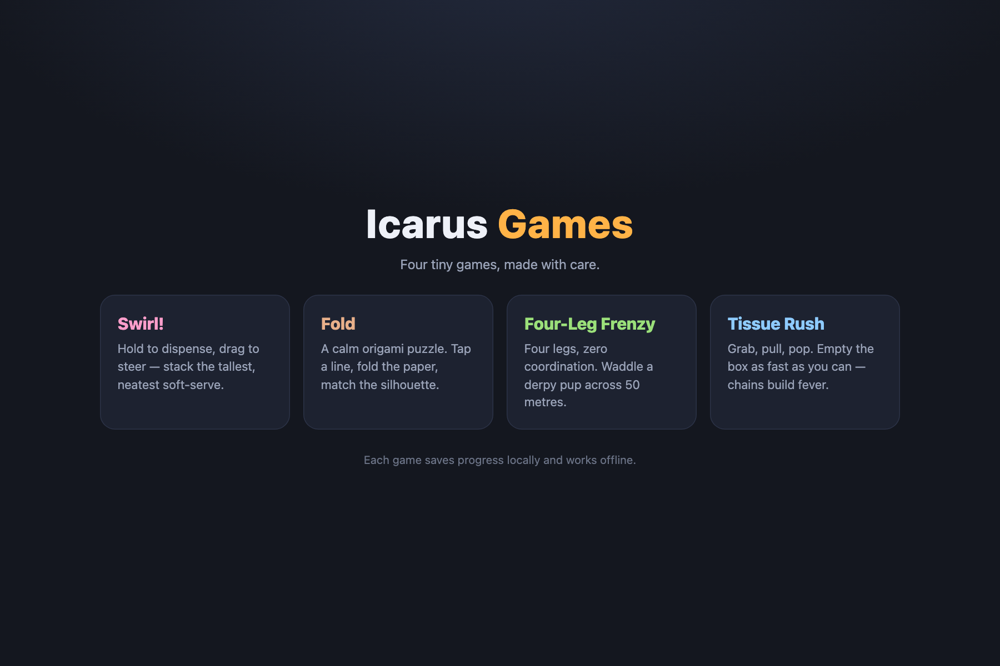
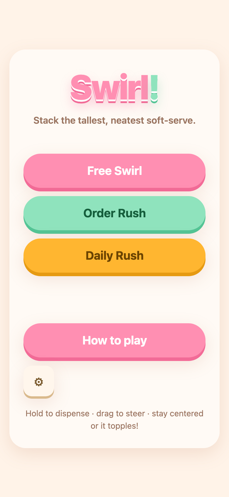
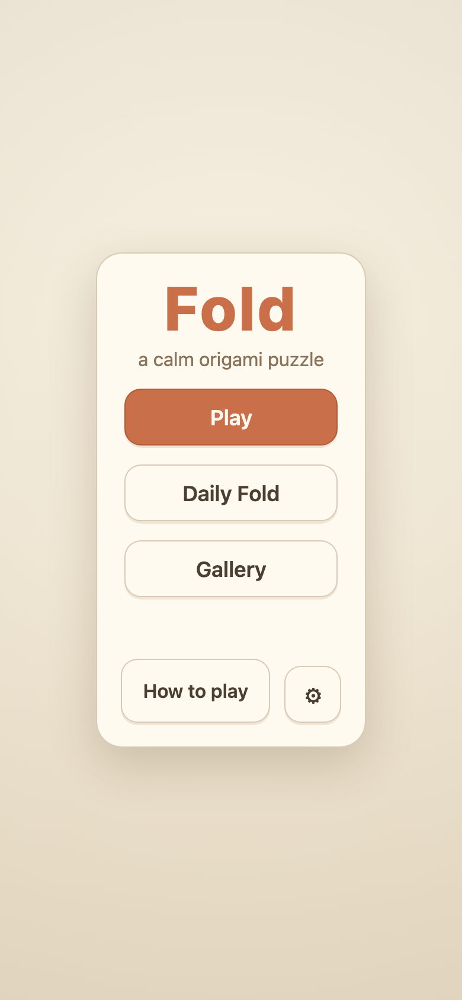
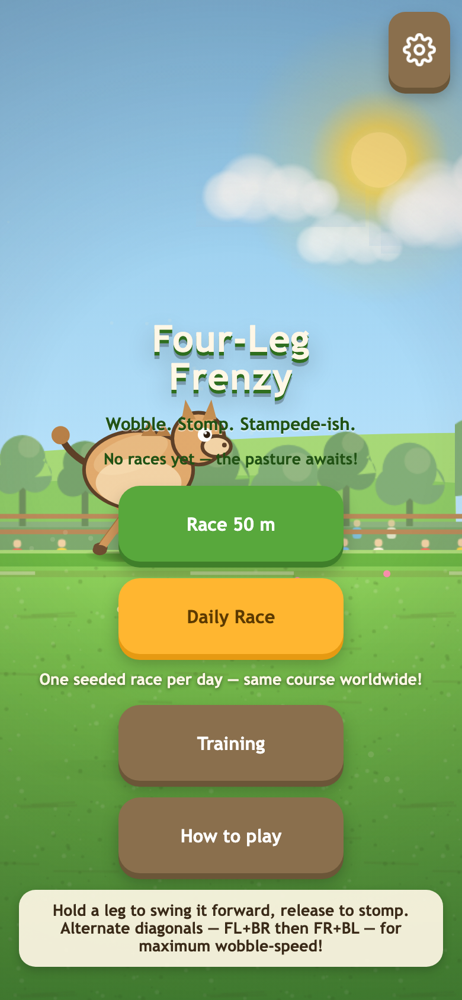
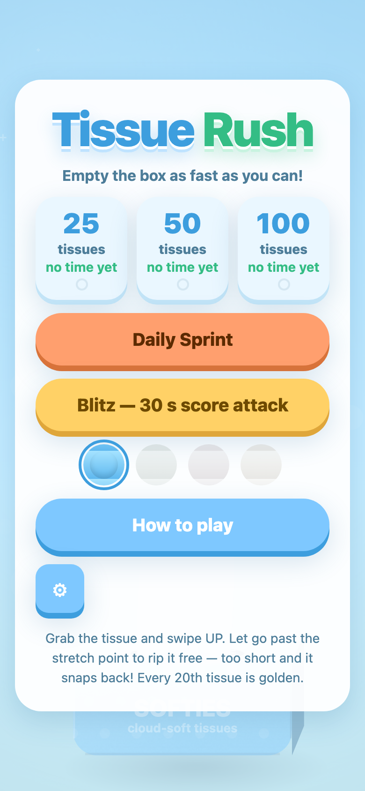

# Icarus Games

Four original casual games from one TypeScript monorepo — built for **YouTube Playables**, with **Android** and **iOS** shells ready via Capacitor.

[](https://github.com/aditybdev/icarus-games/actions/workflows/pages.yml)

**[▶ Play all four games live](https://aditybdev.github.io/icarus-games/)**



## Play now

| Game | Play | What it is |
| --- | --- | --- |
| **Swirl!** | [Play](https://aditybdev.github.io/icarus-games/swirl/) | Hold to dispense, drag to steer — stack the tallest, neatest soft-serve without toppling |
| **Fold** | [Play](https://aditybdev.github.io/icarus-games/fold/) | A calm origami puzzle — tap a dashed line, fold the paper, match the silhouette |
| **Four-Leg Frenzy** | [Play](https://aditybdev.github.io/icarus-games/frenzy/) | Four legs, zero coordination — waddle a derpy pup across 50 m |
| **Tissue Rush** | [Play](https://aditybdev.github.io/icarus-games/tissue/) | Grab, pull, pop — empty the box as fast as you can; chains build fever |

## The games

| | |
| --- | --- |
|  |  |
|  |  |

| App | Package | Highlights | Tech |
| --- | --- | --- | --- |
| `apps/swirl` | `@icarus/swirl` | Free Swirl, Order Rush (endless), Daily Rush; wobble physics, streaks | Three.js, continuous spiral tube mesh |
| `apps/fold` | `@icarus/fold` | 30 hand-designed levels, 3-star scoring, Daily Fold, completion gallery | Canvas 2D + custom geometry engine (reflection, Sutherland–Hodgman clip, ear-clip triangulation) |
| `apps/frenzy` | `@icarus/frenzy` | Race 50 m, Daily Race (seeded), Training; S/A/B grades, stumble & wipeout physics | Canvas 2D, 120 Hz fixed-timestep deterministic physics |
| `apps/tissue` | `@icarus/tissue` | 25/50/100 rounds, Blitz 30 s score attack, Daily Sprint; medals, skins, fever chains | Canvas 2D, verlet cloth ribbon |

Every game: first-launch tutorial (replayable from the title screen), pause/resume,
settings (SFX, haptics, reduced motion), daily mode with streaks, and best-score
persistence — on the Playables host when embedded, with a transparent
`localStorage` fallback on the open web.

## Engineering highlights

- **Shared platform kit** — `packages/platform` (`@icarus/platform`) wraps the
  YouTube Playables SDK behind one typed adapter consumed as TypeScript source:
  environment detection, `firstFrameReady()` → `gameReady()` lifecycle,
  `loadData`/`saveData` persistence, `sendScore()`, host pause/resume binding,
  host audio-state tracking, and health reporting.
- **Pure, testable cores** — each game's rules live in DOM-free modules:
  Fold ships a full geometry engine with an all-30-level solution replay,
  Frenzy proves physics determinism, Tissue Rush a round state machine,
  Swirl scoring/wobble. **328 unit tests** across the workspaces.
- **Procedural everything** — all art is drawn in code and all SFX are
  WebAudio-synthesized. No asset downloads, no fonts, no CDNs: the only
  external request any game makes is the YouTube Playables SDK.
- **Quality gates** — `tsc --noEmit`, vitest, and `vite build` run across all
  workspaces; every push to `main` deploys to GitHub Pages via Actions.

## YouTube Playables

- `index.html` loads `https://www.youtube.com/game_api/v1` synchronously before
  game code; absence of the host is handled gracefully (plain-web mode).
- Lifecycle: `firstFrameReady()` fires after the first painted frame,
  `gameReady()` only once the game is interactable.
- Host pause = full halt: simulation clocks freeze, the render loop stops,
  WebAudio ramps to silence, and even CSS animations pause
  (`body.paused { animation-play-state: paused }`).
- Persistence: every mutation (bests, dailies, settings, tutorial) saves
  eagerly through the kit — string payloads well under the 3 MiB cap,
  garbage-tolerant normalization on load.
- Scores: `engagement.sendScore({ value })` on every finished run.
- Audio: gated on the host's `isAudioEnabled` / `onAudioEnabledChange`, the
  in-game SFX toggle, and pause state — never scheduled on a suspended
  AudioContext.
- `vite.config.ts` uses `base: './'` so bundles work from any host path.

## Develop

```bash
npm install            # once, at the root — installs all workspaces
npm run dev:swirl      # or dev:fold / dev:frenzy / dev:tissue
```

> **Node 24+** is required for the Capacitor CLI. Vite/Vitest work on older Node.

Quality gates (run before shipping):

```bash
npm run typecheck      # tsc --noEmit across all workspaces
npm run test           # vitest across all workspaces
npm run build          # vite build across all games -> apps/<game>/dist
```

To verify a production build locally:

```bash
npm run build
python3 -m http.server 8100
# open http://localhost:8100/apps/<game>/dist/index.html
```

## Android & iOS (Capacitor)

Each app has `capacitor.config.ts` (`webDir: 'dist'`, app id
`com.icarusgames.<game>`) with native shells in `apps/<game>/android` and
`apps/<game>/ios` (store icons and splash screens in `assets/store/`):

```bash
cd apps/<game>
npm run build
npx cap sync           # copy dist into the native shells
npx cap open android   # Android Studio
npx cap open ios       # Xcode
```

Build artifacts (Gradle output, Pods, DerivedData) are git-ignored.

## Repository layout

```
apps/
  swirl/  fold/  frenzy/  tissue/     # the four games (Vite + TS + Capacitor)
packages/
  platform/                           # @icarus/platform shared host adapter
pages/                                # GitHub Pages hub (landing page)
assets/store/                         # store icons + splash screens
docs/screenshots/                     # live captures used in this README
.github/workflows/pages.yml           # build + deploy to GitHub Pages
```

## License

Copyright © 2026 Aditya Bhat / Icarus Games. All rights reserved — see
[LICENSE](LICENSE). The source is publicly visible for platform review; no
reuse rights are granted.
